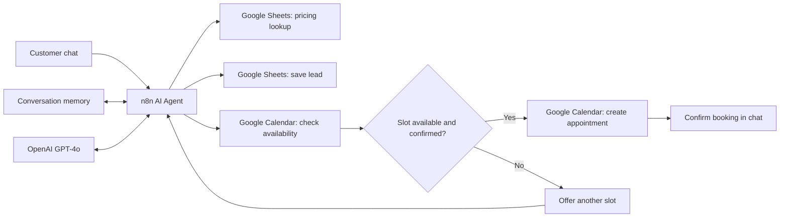

# AI_Customer_Support_Lead_Booking_Agent

**An AI-powered customer assistant built with n8n and OpenAI GPT-4o that answers customer inquiries, retrieves service pricing, captures leads, checks appointment availability, and books meetings.**

## Project Overview

This workflow connects a customer-facing chat interface to an n8n AI agent powered by **OpenAI GPT-4o**. The agent uses Google Sheets as a service-pricing reference and lead CRM, and Google Calendar to check available times and create appointments.

## Features

- **AI customer support:** Responds to customer questions in natural language.
- **Service pricing lookup:** Retrieves service details and pricing from Google Sheets.
- **Automated lead capture:** Saves customer inquiries and contact details to Google Sheets.
- **Calendar availability:** Checks Google Calendar before proposing or confirming meeting slots.
- **Appointment booking:** Creates a Google Calendar event after the customer agrees to an available slot.
- **Conversation memory:** Uses n8n memory to maintain context during customer interactions.

## Workflow Architecture

## Technology Stack

| Technology | Purpose |
| --- | --- |
| n8n | Workflow orchestration and tool connections |
| OpenAI GPT-4o | AI reasoning and conversational responses |
| Google Sheets | Service pricing reference and lead CRM |
| Google Calendar | Availability checking and meeting booking |
| n8n Chat Trigger | Customer-facing chat entry point |
| n8n Memory | Short-term conversation context |

## Example Customer Journey

1. A customer asks about a service and its price.
2. The AI agent looks up the relevant pricing information in Google Sheets and responds.
3. The customer requests a meeting and shares the necessary contact details.
4. The agent saves the lead in Google Sheets and checks Google Calendar for an available slot.
5. Once the customer confirms a suitable time, the agent books the appointment and shares confirmation in the chat.

*Illustrative example only; actual behavior depends on the configured workflow, prompts, permissions, and integrations.*

## Setup

1. Install or access an **n8n** instance.
2. Create an **OpenAI API credential** and configure the AI agent to use **GPT-4o**.
3. Add a **Chat Trigger**, **AI Agent**, and conversation-memory node.
4. Connect a Google Sheets document containing your services and prices.
5. Configure a separate Google Sheets operation for storing lead details.
6. Connect Google Calendar operations for checking availability and creating events.
7. Configure the agent instructions so it checks availability and receives customer confirmation before booking.
8. Test pricing questions, missing contact information, unavailable slots, duplicate submissions, and successful bookings before enabling the workflow.

## Suggested Google Sheets Columns

**Services:** `service_id`, `service_name`, `description`, `price`, `currency`

**Leads:** `created_at`, `customer_name`, `email`, `phone`, `service`, `requested_date`, `booking_status`, `calendar_event_id`

## Security & Reliability

- Store API keys and OAuth credentials in n8n credentials, not in the repository.
- Avoid committing real customer data or private calendar details.
- Validate dates, time zones, and required contact details.
- Check calendar availability again immediately before creating a booking.
- Use deduplication and error handling to prevent accidental repeated bookings.

## Use Cases

Suitable for consulting agencies, IT service providers, marketing teams, professional service businesses, and other organizations handling customer inquiries and meeting requests.

## Project Status

This README documents the architecture and capabilities described for the project. An importable n8n workflow JSON is **not included** here; add your exported workflow after removing credentials and sensitive information.
